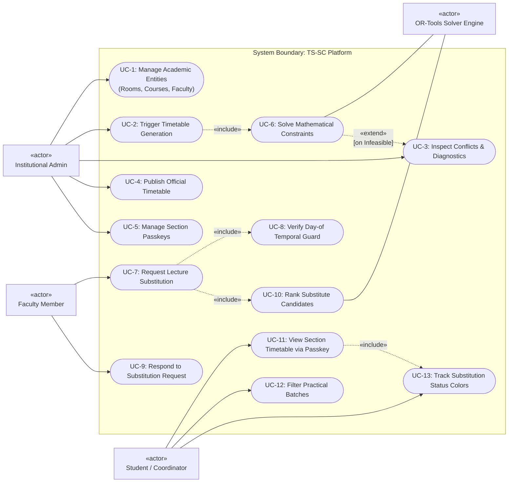
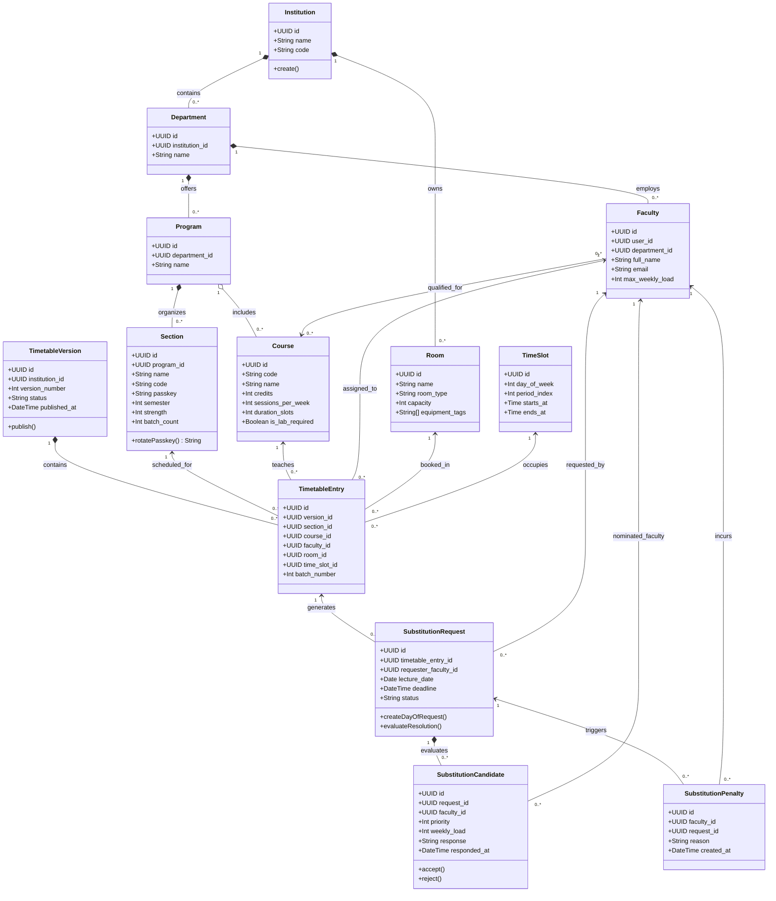
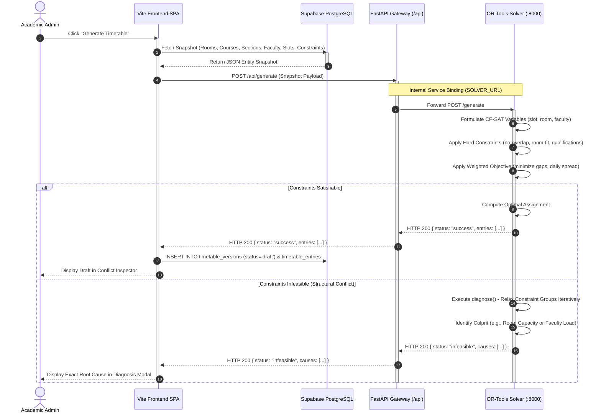
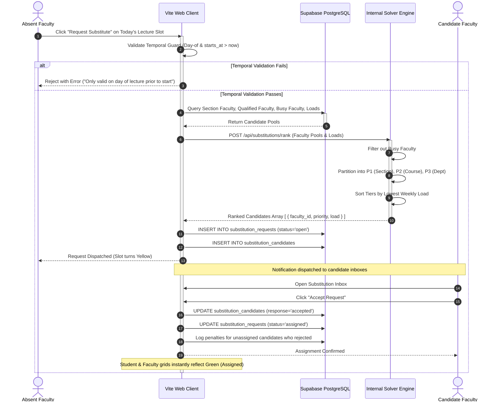
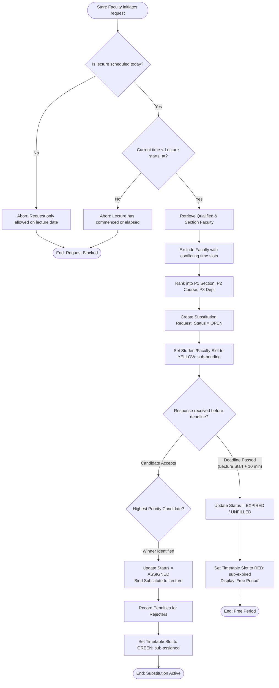
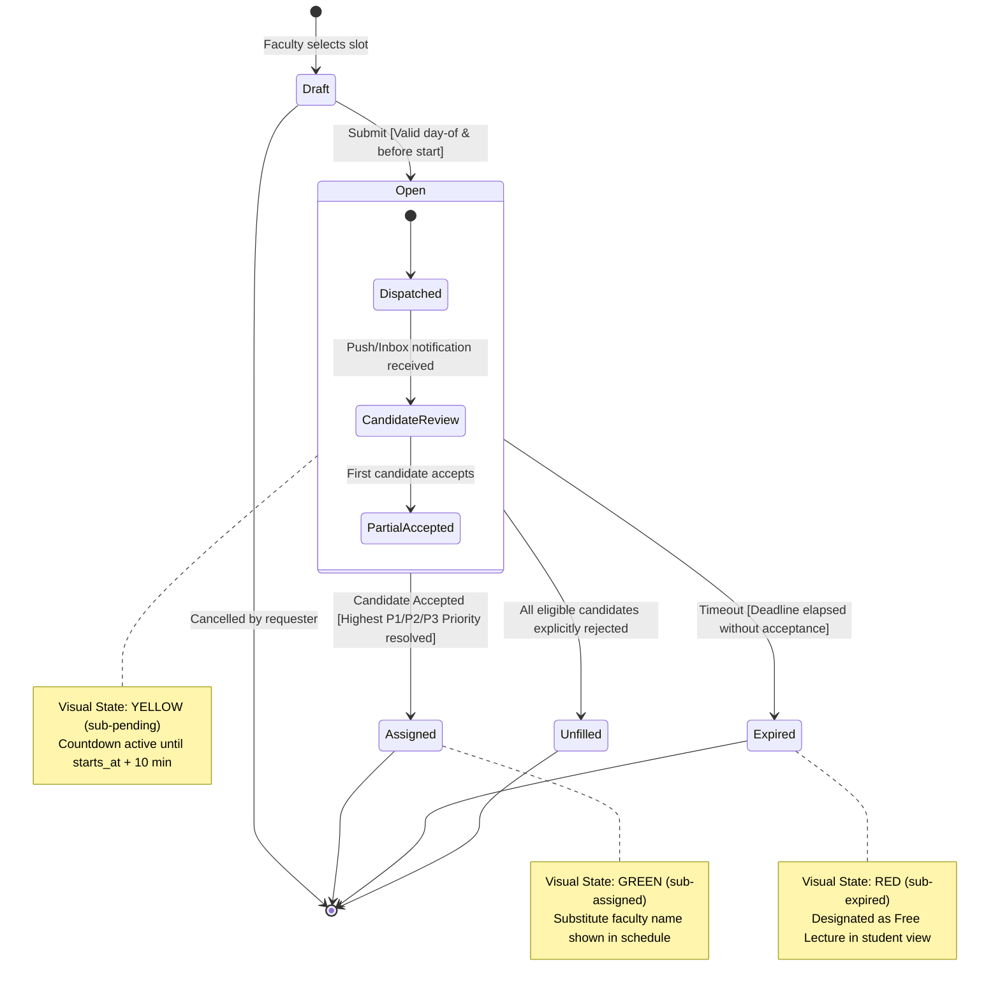
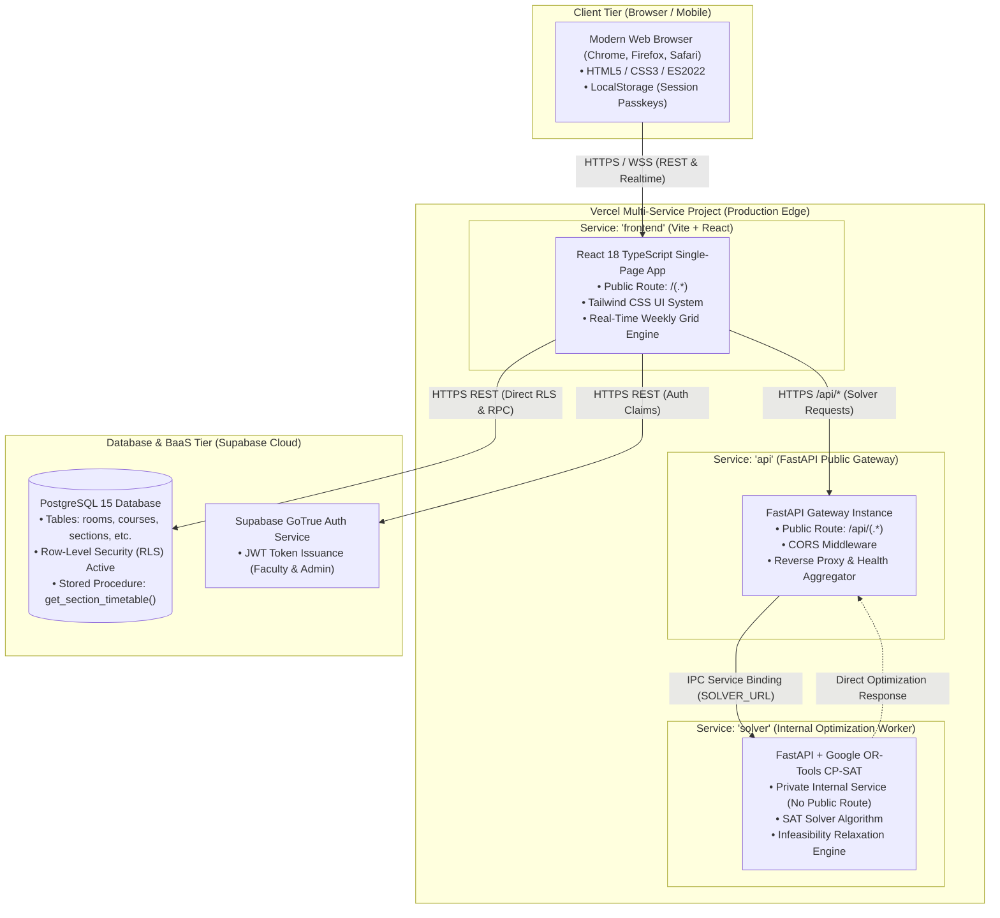

# Software Requirements Specification (SRS)
## Project: Smart Classroom & Timetable Scheduler (TS-SC)

**Document Version:** 2.0 (High-Level Architecture & Implementation Baseline)  
**Standard Compliance:** IEEE Std 830-1998 / ISO/IEC/IEEE 29148 / SEPM Guidelines  
**Status:** Approved Baseline  
**Date:** November 2026  

---

## 1. Introduction

### 1.1 Purpose
This Software Requirements Specification (SRS) document details the high-level functional, non-functional, interface, and behavioral requirements for the **Smart Classroom & Timetable Scheduler (TS-SC)** platform. It reflects the production architecture following iterative development cycles, documenting both initial design requirements and the subsequent architectural shifts (pivots) implemented to enhance privacy, performance, deployment consolidation, and security.

### 1.2 Scope
TS-SC is an automated institutional timetable generation, resource allocation, and dynamic faculty substitution engine designed for higher education institutions (specifically modeled on university departments such as SVVV Indore). The system:
- Automates the computation of mathematically optimal, conflict-free academic schedules using constraint programming (Google OR-Tools CP-SAT).
- Provides instant explainability and constraint-relaxation diagnostics when an academic schedule is mathematically infeasible.
- Orchestrates same-day dynamic faculty substitutions via a three-tier algorithmic priority-ranking engine ($P_1 > P_2 > P_3$).
- Offers zero-account, passkey-secured, privacy-preserving section timetable access for students with real-time visual substitution status tracking.
- Delivers an administrative and faculty resource management interface with hardened authentication boundaries.

### 1.3 Definitions, Acronyms, and Abbreviations

| Term / Acronym | Definition |
|---|---|
| **CP-SAT** | Constraint Programming - Boolean Satisfiability Solver (Google OR-Tools). |
| **RLS** | Row-Level Security in PostgreSQL, enforcing authorization policies at the database engine level. |
| **RPC** | Remote Procedure Call (`SECURITY DEFINER` stored functions executing with elevated database privileges). |
| **BaaS** | Backend-as-a-Service (Supabase: PostgreSQL, Auth, Edge Functions, Realtime). |
| **SEPM** | Software Engineering and Project Management. |
| **SRS** | Software Requirements Specification. |
| **UML** | Unified Modeling Language (Standard Object Management Group specification). |
| **Passkey** | Cryptographically distinct, human-readable section credential (e.g., `H-7216`) distributed offline. |
| **Priority Tiers** | Ranking for faculty substitution: $P_1$ (Same section & free), $P_2$ (Same course qualification & free), $P_3$ (Free faculty in department). |
| **Temporal Rule** | Constraint permitting substitution requests exclusively on the day of the lecture, prior to the lecture start time. |

### 1.4 References
- IEEE Std 830-1998: *Recommended Practice for Software Requirements Specifications*.
- Google OR-Tools CP-SAT Solver Documentation (v9.x).
- Vercel Multi-Service Architecture & Service Bindings Specification (2024+).
- Supabase PostgreSQL Row-Level Security & Remote Procedure Calls Guide.

---

## 2. Overall Description

### 2.1 Product Perspective & Architectural Evolution (Pivot Log)

During system development and deployment testing, critical operational, infrastructural, and privacy constraints prompted key architectural revisions away from the legacy specification:

```
┌────────────────────────────────────────────────────────────────────────────────────────┐
│                               ARCHITECTURAL PIVOT LOG                                 │
├───────────────────────┬───────────────────────────────┬────────────────────────────────┤
│ Feature / Subsystem   │ Legacy SRS Design (v1.0)      │ Revised Production Architecture│
├───────────────────────┼───────────────────────────────┼────────────────────────────────┤
│ Student Account Model │ Individual Supabase Auth      │ Zero-Account Passkey Access:   │
│                       │ accounts (email/password),    │ Students store no PII. Access  │
│                       │ profiles table, student auth. │ via Section Code + Passkey RPC.│
├───────────────────────┼───────────────────────────────┼────────────────────────────────┤
│ Administrative Login  │ Prominent Admin tab on        │ Security by Obscurity:         │
│ Discovery             │ public login landing page.    │ Public login shows Student &   │
│                       │                               │ Faculty. Admin gated in muted  │
│                       │                               │ footer trigger to block probes.│
├───────────────────────┼───────────────────────────────┼────────────────────────────────┤
│ Microservice Hosting  │ External PaaS (Render / Fly)  │ Vercel Multi-Service:          │
│ & Solver Gateway      │ subject to cold starts (1-2m) │ Vite + FastAPI Gateway +       │
│                       │ and distributed domains.      │ internal CP-SAT Solver via     │
│                       │                               │ private IPC service bindings.  │
├───────────────────────┼───────────────────────────────┼────────────────────────────────┤
│ Timetable Color Model │ Binary scheduled/free state.  │ Real-Time Trinary Color States:│
│ for Substitutions     │                               │ 🟡 Yellow: Sub pending/open    │
│                       │                               │ 🟢 Green: Sub assigned         │
│                       │                               │ 🔴 Red: Sub unfilled / expired │
├───────────────────────┼───────────────────────────────┼────────────────────────────────┤
│ Substitution Timing   │ Arbitrary advance scheduling. │ Strict Day-Of Temporal Guard:  │
│ Constraints           │                               │ Requests valid only on lecture │
│                       │                               │ day before lecture starts.     │
└───────────────────────┴───────────────────────────────┴────────────────────────────────┘
```

### 2.2 User Classes and Personas

1. **System Administrator (Academic Registrar / Timetable Coordinator):**
   - Configures academic resources: rooms (type, capacity), programs, departments, courses, faculty qualifications, and time grids.
   - Triggers the automated CP-SAT generation engine and reviews the Conflict Inspector for soft-constraint optimization.
   - Manages and rotates section passkeys, generating exportable distribution rosters for class coordinators.
   - Publishes official timetable versions and monitors institutional faculty penalty metrics.

2. **Faculty Member:**
   - Authenticated user linked directly to institutional department profiles.
   - Views personal weekly schedules, teaching loads, and room assignments.
   - Initiates day-of substitution requests when unavailable.
   - Reviews, accepts, or declines incoming substitution requests dispatched via algorithmic ranking.

3. **Student / Class Coordinator:**
   - Unauthenticated, zero-PII stakeholder.
   - Accesses real-time section schedules via Section Code (e.g., `BTCS27H`) and Coordinator Passkey (e.g., `H-7216`).
   - Toggles laboratory batch filtering (`All Batches`, `Batch 1`, `Batch 2`).
   - Observes live color-coded slot updates for ongoing faculty substitutions without login barriers.

4. **Internal Microservices (Solver & API Gateway):**
   - Headless automated actors executing constraint optimization, candidate scoring, and internal request routing.

---

## 3. System Features & Functional Requirements

### 3.1 Feature Module 1: Institutional Resource & Configuration Management
- **F-REQ-1.1:** The system shall allow administrators to manage rooms with physical capacities and room types (`classroom`, `lab`, `seminar_hall`).
- **F-REQ-1.2:** The system shall maintain course catalogs specifying credits, weekly session frequency, continuous session duration, and laboratory prerequisites.
- **F-REQ-1.3:** The system shall enforce faculty-course qualification mappings, preventing faculty from being scheduled for unqualified subjects.
- **F-REQ-1.4:** The system shall support section partitioning into multiple lab batches (e.g., Batch 1 and Batch 2) for concurrent laboratory scheduling.
- **F-REQ-1.5:** The system shall allow definition of exclusive elective slot-blocks where core courses cannot be scheduled.

### 3.2 Feature Module 2: Automated Conflict-Free Timetable Generation
- **F-REQ-2.1 (Hard Constraint - Resource Singularity):** No room, faculty member, or student section shall be assigned to more than one session in any given time slot.
- **F-REQ-2.2 (Hard Constraint - Capacity & Type Match):** Laboratory courses must be assigned to laboratory rooms; theory courses must be assigned strictly to classrooms; room capacity must be $\ge$ section strength (or batch strength for practicals).
- **F-REQ-2.2b (Hard Constraint - Section Theory Room Consistency):** All theory sessions of any student section shall be held in the exact same assigned classroom (home classroom). Practical lab sessions move to specialized laboratories. Where available classrooms $\ge$ sections, each section is allocated a distinct dedicated classroom.
- **F-REQ-2.3 (Hard Constraint - Workload Limit):** Weekly scheduled hours for each faculty member shall not exceed their configured maximum weekly load.
- **F-REQ-2.4 (Soft Constraint - Gap Minimization):** The optimization model shall penalize single-period idle gaps in student daily schedules.
- **F-REQ-2.5 (Soft Constraint - Daily Spread):** Sessions of the same multi-credit course shall be evenly distributed across distinct days of the academic week.
- **F-REQ-2.6 (Infeasibility Diagnostics):** When constraints are mathematically irreconcilable, the solver shall execute iterative constraint relaxation (loads, rooms, qualifications, electives) and output the exact structural cause of failure.

### 3.3 Feature Module 3: Dynamic Same-Day Faculty Substitution Engine
- **F-REQ-3.1 (Temporal Enforcement):** Faculty can request substitutions only on the same calendar day as the scheduled lecture and prior to the slot's start time.
- **F-REQ-3.2 (Algorithmic Ranking):** When a request is created, the system shall compute eligible substitute faculty filtered by zero slot conflicts and rank them by:
  - **Priority 1 ($P_1$):** Faculty currently assigned to teach the same section in another course.
  - **Priority 2 ($P_2$):** Faculty qualified to teach the specific course.
  - **Priority 3 ($P_3$):** Any free faculty member belonging to the same academic department.
  - *Tie-Breaker:* Lowest cumulative weekly teaching load, followed by earliest response timestamp.
- **F-REQ-3.3 (State Transitions):**
  - **Open / Pending:** Broadcasted to eligible candidates.
  - **Assigned:** First valid candidate accepted or resolved by deadline.
  - **Unfilled / Expired:** If the request remains unassigned 10 minutes post-commencement, the slot is marked as a Free Lecture.
- **F-REQ-3.4 (Penalty Tracking):** Declining or failing to respond to a substitution request shall log a penalty record against the faculty profile for administrative audit.

### 3.4 Feature Module 4: Zero-Account Student Passkey Access
- **F-REQ-4.1 (Privacy Preservation):** The system shall strictly prohibit storing student identities, names, or email accounts in the database.
- **F-REQ-4.2 (Cryptographic RPC Verification):** Timetable data for students shall only be accessible through the PostgreSQL `SECURITY DEFINER` function `get_section_timetable(p_code, p_passkey)`.
- **F-REQ-4.3 (Live Slot Highlighting):** The student timetable grid shall visually indicate substitutions:
  - 🟡 **Yellow (`sub-pending`):** Dispatched substitution pending confirmation.
  - 🟢 **Green (`sub-assigned`):** Substitute faculty assigned and confirmed.
  - 🔴 **Red (`sub-expired`):** Request expired without assignment (Free period).
- **F-REQ-4.4 (Batch Filtering):** Students shall be able to filter practical lab sessions by Batch 1, Batch 2, or All Batches directly in the user interface.

### 3.5 Feature Module 5: Secure Authentication & Discovery Boundary
- **F-REQ-5.1:** Default authentication route (`/login`) shall display only Student Passkey Access and Faculty Sign-In.
- **F-REQ-5.2:** Administrative login credentials and input forms shall remain hidden behind a discrete, unstyled trigger to minimize exposure to automated vulnerability crawlers.

---

## 4. External Interface & Architectural Requirements

### 4.1 Vercel Multi-Service Topography

The system deploys as a consolidated Vercel Project containing three distinct services interacting via internal service bindings:

```
                          Internet (HTTPS)
                                 │
           ┌─────────────────────┴─────────────────────┐
           │                                           │
    Rewrite: /api/(.*)                          Rewrite: /(.*)
           ▼                                           ▼
┌───────────────────────────┐               ┌───────────────────────────┐
│     Service: "api"        │               │   Service: "frontend"     │
│   FastAPI Public Gateway  │               │   Vite + React + TS SPA   │
│   (Port 8001 / Serverless)│               │   (Static CDN Edge)       │
└─────────────┬─────────────┘               └─────────────┬─────────────┘
              │                                           │
  Internal IPC Service Binding:                           │ Supabase JS SDK
  format="url", env="SOLVER_URL"                          │ (HTTPS / WSS)
              ▼                                           │
┌───────────────────────────┐                             │
│    Service: "solver"      │                             │
│   Internal CP-SAT Engine  │                             │
│   (Port 8000 / Internal)  │                             │
└───────────────────────────┘                             ▼
                                            ┌───────────────────────────┐
                                            │      Supabase Cloud       │
                                            │  Postgres 15 + RLS + RPC  │
                                            └───────────────────────────┘
```

---

## 5. Conceptual Models & UML Diagrams (SEPM Standards)

### 5.1 UML Use Case Diagram

The Use Case Diagram defines the interactions between the system actors and core use cases, showing `<<include>>` and `<<extend>>` dependencies.



---

### 5.2 UML Class Diagram

The Class Diagram documents the domain data model, attributes, types, visibility, methods, and associations (composition, aggregation, multiplicity).



---

### 5.3 UML Sequence Diagram: Timetable Generation & Infeasibility Analysis

This sequence details the interaction among the Administrator, the Vite Frontend, Supabase Database, the Public API Gateway, and the internal OR-Tools CP-SAT Solver.



---

### 5.4 UML Sequence Diagram: Priority-Based Faculty Substitution Lifecycle

This sequence illustrates the same-day substitution workflow, algorithmic candidate scoring, and state resolution.



---

### 5.5 UML Activity Diagram: Substitution Request Evaluation Workflow

This activity diagram captures the branching decisions, deadlines, penalty assignments, and UI visual state switches.



---

### 5.6 UML State Machine Diagram: Substitution Request Entity States

Models the complete state lifecycle of a `SubstitutionRequest` entity.



---

### 5.7 UML Deployment Diagram: Consolidated Vercel Multi-Service Architecture

The deployment diagram illustrates the physical and virtual execution nodes, artifact packaging, execution environments, and network protocols.



---

## 6. Non-Functional Requirements (NFR)

### 6.1 Performance and Response Times
- **NFR-P1 (Timetable Solving Latency):** The CP-SAT engine shall solve standard department workloads ($\le 60$ sections, $\le 500$ weekly course sessions) within **120 seconds**.
- **NFR-P2 (RPC Query Latency):** Student section timetable queries via the `get_section_timetable` RPC shall return within **300 milliseconds** under standard network conditions.
- **NFR-P3 (Vite Cold Build Time):** Incremental production build duration for the frontend shall not exceed **15 seconds**.

### 6.2 Security and Integrity
- **NFR-S1 (Zero-Trust Student Privacy):** No personal identifiable information (PII) such as student enrollment IDs, names, or contact data shall be stored in any database table.
- **NFR-S2 (RPC Encapsulation):** Student schedule retrieval must execute under a `SECURITY DEFINER` stored function that isolates access solely to verified section codes and matching passkeys.
- **NFR-S3 (Admin Route Obfuscation):** The administrative authentication mechanism must remain unindexed and hidden behind an opaque trigger to eliminate automated dictionary attack vectors.
- **NFR-S4 (Row-Level Security):** All database tables must have PostgreSQL RLS enabled; faculty roles must be cryptographically restricted to their own substitution records and institutional department context.

### 6.3 Reliability & Availability
- **NFR-R1 (Zero Cold Starts):** Deployment on Vercel services with multi-service binding shall eliminate the 1-2 minute inactive spin-up latency characteristic of legacy free-tier PaaS providers.
- **NFR-R2 (Explainable Infeasibility):** The timetable solver shall never fail silently; when an infeasible state occurs, a diagnostic relaxation breakdown shall identify the violating constraint group.

---

## 7. Requirements Traceability Matrix (RTM)

| Requirement ID | Module / Component | UML Artifact Reference | Verification Method | Status |
|---|---|---|---|---|
| **F-REQ-1.1 – 1.5** | Resource Management | Class Diagram (`Room`, `Course`, `Section`) | Integration Test | Implemented |
| **F-REQ-2.1 – 2.3** | CP-SAT Hard Constraints (Singularity, Fixed Home Classroom, Workload) | Sequence Diagram (5.3), Class Diagram | Solver Unit Test | Implemented |
| **F-REQ-2.4 – 2.5** | Soft Optimization (Gaps/Spread) | Sequence Diagram (5.3) | Benchmarking Suite | Implemented |
| **F-REQ-2.6** | Infeasibility Diagnostics | Sequence Diagram (5.3, alt branch) | Diagnostic Test | Implemented |
| **F-REQ-3.1** | Day-Of Temporal Guard | Sequence Diagram (5.4), Activity Diagram | Unit Test (`getLectureTemporalStatus`) | Implemented |
| **F-REQ-3.2** | Algorithmic P1/P2/P3 Ranking | Class Diagram, Activity Diagram (5.5) | Ranking Test Suite | Implemented |
| **F-REQ-3.3** | Real-Time Substitution States | State Machine Diagram (5.6), Activity | UI Integration Test | Implemented |
| **F-REQ-4.1 – 4.2** | Zero-Account Passkey Access | Use Case (UC-11), Deployment Diagram | Security Penetration Audit | Implemented |
| **F-REQ-4.3** | Color-Coded Timetable Grid | State Machine Diagram (5.6) | UI Snapshot Test | Implemented |
| **F-REQ-5.1 – 5.2** | Obfuscated Administrative Login | Use Case (UC-1), Deployment Diagram | Vulnerability Scan | Implemented |
| **NFR-R1** | Vercel Multi-Service Binding | Deployment Diagram (5.7) | End-to-End Latency Probe | Implemented |

---
*End of Software Requirements Specification (SRS) Document.*

