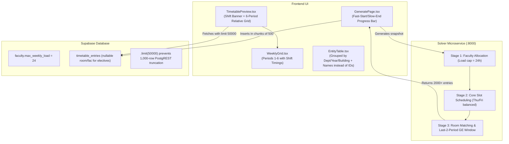

# Comprehensive Timetable & UI Optimization Plan

This plan addresses all 6 required fixes across the solver microservice, database migrations, frontend UI, and admin views.

---

## 1. Goal Description
The objective is to fix:
1. **Thursday & Friday Timetable Scheduling & Visibility**: Ensure normal theory/lab lectures are properly distributed across all 5 weekdays (Monday through Friday), and Generic Electives (GE) are strictly confined to the *last two periods* of each shift on Thursday and Friday without starving regular classes or getting truncated by Supabase queries.
2. **Faculty Max Load = 24 hrs/week**: Enforce 24 hours/week default and maximum workload across database schema, seed scripts, and solver allocator.
3. **Replace Raw UUIDs with Human-Readable Names**: Replace unreadable database IDs (e.g. `fb13f044-...`) with friendly names (Faculty Name, Department Name, Course Code & Name, Room Name, Section Name) everywhere in the UI (Entity tables, Inspect page load balance, version history).
4. **Shift-Relative 6-Period Timetable Grid**:
   - Shift 1 (Year 1 & 4): Displays Periods 1 to 6 (08:15 AM – 02:45 PM).
   - Shift 2 (Year 2 & 3): Displays Periods 1 to 6 (10:15 AM – 04:45 PM).
   - Above the timetable, render a clear **Shift Banner** with timings and lunch break (12:15 – 12:45 PM).
5. **Categorized & Grouped Admin Master Data**:
   - **Programs**: Grouped by Department.
   - **Sections**: Grouped by Academic Year and Department.
   - **Rooms**: Grouped by Building / Facility Type.
6. **Timetable Generation Progress Bar**:
   - Implement an interactive progress bar using the **Fast-Start / Slow-End UX pattern** with real-time status captions during the 30–45s CP-SAT solver execution.

---

## 2. Architecture & Detailed Analysis



---

## 3. Detailed Fix Breakdown

### Fix 1: Assignments for Thursday and Friday
**Root Causes:**
1. PostgREST's default query limit is **1,000 rows**. With 2,189 timetable entries, queries in `TimetablePreview.tsx` were silently truncated at row 1,000, cutting off Thursday and Friday for over half the institute's sections!
2. The solver previously reserved `periods in (5, 6, 7, 8)` on both Thursday and Friday for Shift 2, which over-blocked 4 out of 6 periods of the day for Shift 2.
3. `timetable_entries` enforced `not null` on `room_id` and `faculty_id`, causing conflicts when electives are independent of home classrooms and departmental faculty.

**Fixes:**
1. In `TimetablePreview.tsx`: Add `.limit(50000)` to the `timetable_entries` select query.
2. In `GeneratePage.tsx`: Batch-insert timetable entries in chunks of 500 to ensure reliable database persistence.
3. In `solver/app/solver.py`:
   - Elective reserved windows per shift:
     - Shift 1: Thursday periods 5 & 6; Friday periods 5 & 6 (last two lectures of Shift 1).
     - Shift 2: Thursday periods 7 & 8; Friday periods 7 & 8 (last two lectures of Shift 2).
   - Core courses for Shift 2 can freely use Thursday & Friday periods 3, 4, 5, 6.
   - Core courses for Shift 1 can freely use Thursday & Friday periods 1, 2, 3, 4.
   - Sections without electives have all periods available across all 5 days.
4. Database migration: Make `room_id` and `faculty_id` in `timetable_entries` nullable so independent generic electives don't clash or fail constraint checks.

---

### Fix 2: Faculty Max Load = 24 hrs/week
1. Create migration `0017_faculty_max_load_24.sql`:
   ```sql
   alter table if exists public.faculty alter column max_weekly_load set default 24;
   update public.faculty set max_weekly_load = 24 where max_weekly_load != 999;
   ```
2. In `seed_large.sql`: Include the 24 default and ensure all faculty records insert with `24`.
3. In `frontend/src/lib/entities.ts`: Set default value for faculty `max_weekly_load` to 24.
4. In `solver/app/solver.py`: Ensure faculty allocation enforces 24h weekly load limit.

---

### Fix 3: Display Human-Readable Names Instead of UUIDs
1. **In `EntityTable.tsx`**:
   - Add `.limit(50000)` to all reference fetching queries so no reference rows are cut off.
   - For all foreign key reference columns (`department_id`, `program_id`, `course_id`, `faculty_id`, `room_id`, `section_id`), resolve the UUID to its human label (`Name` or `Code — Name`).
   - If an unmapped UUID is encountered, show a truncated badge with tooltip instead of a raw 36-character string.
2. **In `InspectPage.tsx`**:
   - In "Faculty Teaching Load Balance": Fetch faculty names and render `<span className="font-semibold">{facultyName}</span>` instead of raw UUID/ID.
   - In version headers: Replace `Version 5a88aa56` with `Draft / Published · Generated [Date, Time]`.
3. **In `AdminDashboard.tsx`**:
   - Replace version ID slices with friendly formatted timestamps and status labels.

---

### Fix 4: Shift-Relative 6-Period Timetable Grid
**Requirement:** In Timetable Preview, do not label columns 1 to 8. Mention the shift above the timetable, and range the columns from **Period 1 to Period 6**, showing start and end times according to the active shift.

1. **Shift Header Banner above Timetable**:
   - When a Section is selected, inspect its shift:
     - **Shift 1 Banner**:
       `First Shift (Year 1 & 4) · Morning: 08:15 AM – 02:45 PM · Lunch Break: 12:15 – 12:45 PM`
     - **Shift 2 Banner**:
       `Second Shift (Year 2 & 3) · Afternoon: 10:15 AM – 04:45 PM · Lunch Break: 12:15 – 12:45 PM`
2. **Column Period Mapping (1 to 6)**:
   - Always render exactly 6 periods: `Period 1` to `Period 6`.
   - **For Shift 1**:
     - Period 1: `08:15 – 09:15`
     - Period 2: `09:15 – 10:15`
     - Period 3: `10:15 – 11:15`
     - Period 4: `11:15 – 12:15`
     - *(Lunch: 12:15 – 12:45)*
     - Period 5: `12:45 – 13:45`
     - Period 6: `13:45 – 14:45`
   - **For Shift 2**:
     - Period 1: `10:15 – 11:15` (global slot period 3)
     - Period 2: `11:15 – 12:15` (global slot period 4)
     - *(Lunch: 12:15 – 12:45)*
     - Period 3: `12:45 – 13:45` (global slot period 5)
     - Period 4: `13:45 – 14:45` (global slot period 6)
     - Period 5: `14:45 – 15:45` (global slot period 7)
     - Period 6: `15:45 – 16:45` (global slot period 8)
   - Entries for Shift 2 with global period $p \in [3..8]$ map to relative period $p - 2$.
   - Generic Electives on Thursday & Friday for both shifts now naturally appear in **Period 5 & Period 6 (the last two periods)**!

---

### Fix 5: Grouping Admin Master Data
In `EntityTable.tsx`, add collapsible and visually distinct group headers:
- **`programs`**: Group by `Department` (e.g., *Computer Science & Engineering*, *Artificial Intelligence & Data Science*, *Information Technology*, *Industry Programs*).
- **`sections`**: Group by `Academic Year` and `Department` (e.g., *Year 1 · CSE*, *Year 2 · IT*, etc.) with count badges.
- **`rooms`**: Group by `Building / Wing` (e.g., *Main Academic Block*, *Engineering Annex*, *Specialized Computing Labs*, *Seminar Halls*).
- Include group toggle collapse/expand and a search bar that filters across groups.

---

### Fix 6: Fast-Start / Slow-End Timetable Generation Progress Bar
In `GeneratePage.tsx`:
- When generation is triggered (`busy === true`):
  - Launch an interval timer animating a progress bar from 0% to 100%.
  - **Fast-Start Phase (0 – 3s)**: Quickly rises to ~25% (`"Loading curriculum data and validating shifts..."`).
  - **Stage 1 Phase (3 – 8s)**: Smoothly transitions to ~45% (`"Stage 1: Allocating balanced faculty teaching loads (Max 24h/wk)..."`).
  - **Stage 2 Phase (8 – 25s)**: Progresses through ~70% (`"Stage 2: CP-SAT solving core lecture slots & parallel lab batches..."`).
  - **Stage 3 / Slow-End Phase (25 – 40s)**: Slowly inches from 75% to 92% (`"Stage 3: Physical room matching and elective block verification..."`).
  - **Completion**: When the solver API returns, progress instantly snaps to **100%**, displays a success checkmark, shows the execution time, and displays the freshly generated timetable!

---

## 4. Verification Plan

### Automated Tests
1. Run backend unit tests:
   ```powershell
   solver\.venv\Scripts\pytest solver/tests
   ```
2. Test full institutional solve with updated Thursday/Friday elective windows and 24h faculty limit:
   ```powershell
   solver\.venv\Scripts\python scripts/debug_large_solve.py
   ```
3. Test frontend build:
   ```powershell
   npm --prefix frontend run build
   ```

### Manual Verification
1. Open Admin Timetable Preview:
   - Check that the active shift is displayed above the timetable.
   - Confirm table columns show **Period 1 to Period 6** with shift-accurate time labels.
   - Verify Thursday and Friday have scheduled sessions visible.
2. Open Admin Data:
   - Check `/admin/data/programs` grouped by Department.
   - Check `/admin/data/sections` grouped by Year & Department.
   - Check `/admin/data/rooms` grouped by Building.
   - Verify no raw UUIDs appear anywhere in table rows.
3. Trigger Timetable Generation:
   - Verify the animated Fast-Start / Slow-End progress bar and status captions.
